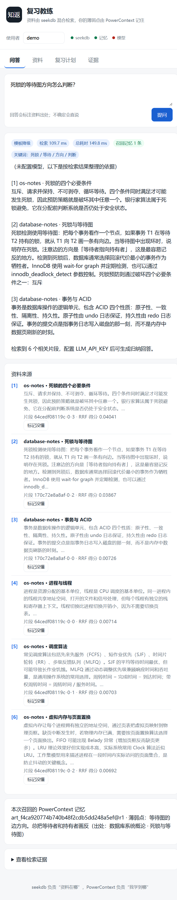
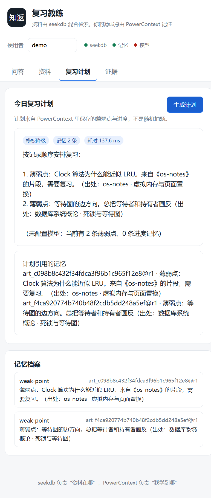
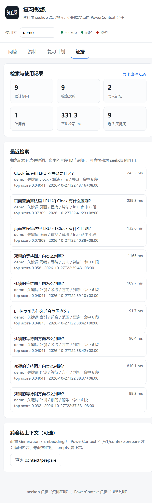

# 知返 · 复习教练

一个把「资料」和「学习状态」分开管理的复习助手：

- **seekdb 负责「资料在哪」**：笔记切块后写入 seekdb，提问时用「向量 + 全文」两条通道检索，返回带出处（文档 / 章节 / chunk_id / 分数）的片段。
- **PowerContext 负责「我学到哪」**：把「没懂」的知识点写成原子记忆（`artifact_id@revision`），下一次提问、复习计划自动召回。
- 没有模型 API Key 也能完整跑通：回答会降级成「按检索结果整理的依据」，检索与记忆闭环不受影响；配置 Key 后由模型归纳回答和生成计划。

> 项目资产位于 PowerContext `2026-competition-ecosystem` 分支的 `qoder/` 目录，开发在 Qoder 中完成。
>
> 项目网站（Qoder Sites，任何人可访问）：<https://zhifan-review-coach-lob7r2wwvmq.qoder.zone>



## 1. 技术分工（不是「只装了组件」）

| 用户动作 | seekdb 做什么 | PowerContext 做什么 | 可核对的位置 |
| --- | --- | --- | --- |
| 导入 / 上传笔记 | 存 chunk 文本、元数据与 384 维向量（HNSW，cosine） | — | `/api/health` 的 collection / dimension / chunks |
| 提问 | 向量通道 `query` + 全文通道 `$contains`，返回命中片段 | 按用户 Scope 召回历史薄弱点 | 回答里的引用；`/api/evidence` 的 chunk_ids、关键词、耗时 |
| 标记「没懂」 | — | 写入 `weak-point` 原子记忆 | 返回 `art_...@r1`；`/api/memories` |
| 再次提问 | 继续找资料 | `/v1/memory/search` 召回该记忆并注入提示词 | 回答里的「记忆」区块、`matched_by` |
| 生成复习计划 | 为薄弱点补充资料片段 | 读取 Scope 内的薄弱点 / 进度 | `/api/plan` 的 `weak_points[].artifact_id` |

PowerContext 的自动抽取、Topic Memory、语义记忆检索需要 Generation / Embedding 凭据；本项目核心流程走的是 **显式 remember / search（base-memory 模式）**，所以没有模型也能验证。配置模型后，`/v1/context/prepare` 会返回内容（证据页保留了探测按钮，未配置时如实显示 `empty`）。

## 2. 功能

- **带出处问答**：每条引用包含文档、章节、页码、`chunk_id`、RRF 分数；资料不足时明确说「资料里没有提到」。
- **标记没懂**：引用下方点「标记没懂」，行内填写概念，写入当前用户的 PowerContext Scope。
- **复习计划**：只根据记忆里的薄弱点与进度生成，不随机抽题；计划下方列出引用的 `artifact_id@revision`。
- **记忆档案**：查看当前用户全部记忆及状态。
- **证据面板**：累计提问 / 检索 / 写入记忆 / 活跃用户、平均耗时、最近检索明细（关键词、命中的片段 ID、top score）、事件 CSV 导出。
- **多用户隔离**：每个 `user_key` 对应一个独立 Scope（`study-coach:<user_key>`）。
- **降级策略**：LLM 未配置 → 模板回答；本地嵌入 → 关键词通道加权补偿中文语义不足。

## 3. 目录结构

```
qoder/
├─ app/
│  ├─ main.py              FastAPI 入口与 API
│  ├─ tutor.py             业务编排（检索 → 召回 → 回答 / 计划）
│  ├─ ingest.py            Markdown / PDF 切块
│  ├─ embedding.py         本地 / API 向量模型
│  ├─ llm.py               OpenAI 兼容客户端
│  ├─ store/seek.py        seekdb 写入与混合检索（RRF 融合）
│  ├─ store/memory.py      PowerContext Scope / 记忆 / 召回
│  ├─ store/db.py          SQLite：文档、检索日志、问答日志、事件
│  └─ static/              单页前端（无构建步骤）
├─ data/samples/           两份示例笔记（自写，8 个 chunk）
├─ site/                   项目网站（纯静态，Qoder Sites 发布）
├─ docs/screenshots/       运行截图
├─ scripts/
│  ├─ start.sh             Linux / WSL 启动
│  ├─ start.ps1            Windows 原生启动
│  └─ verify.py            端到端验证样例
├─ .env.example            配置模板（占位值，不含凭据）
└─ pyproject.toml
```

## 4. 环境与版本（实测）

| 组件 | 版本 / 说明 |
| --- | --- |
| Python | 3.12.3（WSL）/ 3.12.12（Windows，uv 管理） |
| PowerContext | 1.4.1（`uv tool install "powercontext[cli,server]==1.4.1"`） |
| pyseekdb | 1.4.0.post1（内置 `all-MiniLM-L6-v2`，384 维） |
| seekdb | Docker `oceanbase/seekdb:latest`，digest `sha256:4db49618…a956b`（端口 2881 / 2886） |
| FastAPI / Uvicorn | 0.162.0 / 0.54.0 |
| 其他 | jieba 0.42.1、pypdf 6.21.3、httpx 0.28.1 |
| 宿主 | Windows 10.0.26200 + WSL2 Ubuntu；Docker Desktop 29.5.3 |

两种运行方式均已验证：

- **A. Windows 原生 + Docker seekdb（推荐 Windows 用户）**
- **B. WSL / Linux + seekdb 嵌入式**（无需 Docker；嵌入式模式不支持 Windows）

## 5. 安装与启动

### 5.0 准备

```bash
# 安装 uv（已安装可跳过）
python -m pip install --user uv
# 国内网络可给 uv 配镜像
export UV_DEFAULT_INDEX=https://pypi.tuna.tsinghua.edu.cn/simple
```

```bash
# 安装 PowerContext
uv tool install "powercontext[cli,server]==1.4.1"
# 确认命令可用（Windows 为 %USERPROFILE%\.local\bin\powercontext.exe）
powercontext --version
```

> PATH 中没有 `powercontext` 时，把 `~/.local/bin`（Windows 为 `%USERPROFILE%\.local\bin`）加入 PATH。

```bash
# 应用依赖（会自动创建 .venv）
cd qoder
uv sync --python 3.12
cp .env.example .env
```

### 5.1 方式 A：Windows 原生 + Docker seekdb（已验证）

```powershell
# 1) 启动 seekdb（Docker Desktop 需先运行）
docker run -d --name seekdb -p 2881:2881 -p 2886:2886 oceanbase/seekdb:latest

# 2) 建库（远程模式需要预先存在该 database）
docker exec seekdb mysql -h127.0.0.1 -P2881 -uroot -e "CREATE DATABASE IF NOT EXISTS study_coach;"

# 3) 修改 qoder\.env
#    SEEKDB_MODE=remote
#    SEEKDB_HOST=127.0.0.1
#    SEEKDB_PORT=2881
#    SEEKDB_USER=root
#    SEEKDB_PASSWORD=
#    SEEKDB_DATABASE=study_coach
#    国内网络首次运行建议加：HF_ENDPOINT=https://hf-mirror.com

# 4) 启动 PowerContext（自动）+ 应用
powershell -ExecutionPolicy Bypass -File scripts\start.ps1
```

打开 <http://127.0.0.1:8080>。PowerContext 在 <http://127.0.0.1:8000>（Dashboard：`/dashboard/`）。

> 国内拉取 Docker Hub 失败时，可用镜像仓库并重新打标签：
> `docker pull docker.m.daocloud.io/oceanbase/seekdb:latest`
> `docker tag docker.m.daocloud.io/oceanbase/seekdb:latest oceanbase/seekdb:latest`

### 5.2 方式 B：WSL / Linux + 嵌入式 seekdb（已验证）

```bash
# .env 保持默认：SEEKDB_MODE=embedded、SEEKDB_PATH=./data/seekdb
bash scripts/start.sh
```

嵌入式模式会在 `qoder/data/seekdb/` 下创建本地库，无需 Docker；首次运行会下载约 86MB 的嵌入模型。

### 5.3 可选：接入云端 LLM / API 向量

在 `.env` 中填写（**不要提交真实 Key**）：

```ini
LLM_BASE_URL=https://api.deepseek.com/v1
LLM_API_KEY=<你的 Key>
LLM_MODEL=deepseek-chat

# 可选：中文语义更好的向量接口（OpenAI 兼容 /embeddings）
EMBEDDING_MODE=api
EMBEDDING_BASE_URL=<接口地址>
EMBEDDING_API_KEY=<你的 Key>
EMBEDDING_MODEL=<模型名>
```

不配置也能运行，健康检查与回答里会明确标注「模板降级」。

## 6. 验证样例（可复现）

**初始数据**：`data/samples/database-notes.md`、`data/samples/os-notes.md`，共 2 个文件、8 个片段。

**输入问题**：`页面置换算法里 LRU 和 Clock 有什么区别？`

**步骤**：

```bash
# 服务启动后，另开一个终端
python scripts/verify.py --base http://127.0.0.1:8080
# Windows 用：.venv\Scripts\python.exe scripts\verify.py --base http://127.0.0.1:8080
```

脚本会自动完成：导入样例 → 提问 → 校验两条检索通道与出处 → 标记没懂 → 再次提问校验记忆召回 → 生成计划 → 读取证据统计，共 15 项检查。

**预期结果**：

- seekdb：collection `materials_384`、384 维、8 个片段；向量通道与全文通道均有命中；首条引用命中「os-notes · 虚拟内存与页面置换」。
- PowerContext：写入形如 `art_…@r1` 的薄弱点；下一次提问 `matched_by=["text"]`；计划 `weak_points` 引用同一 `artifact_id`。
- 统计：`memories_written ≥ 1`，检索日志可查到 chunk_id 与耗时。

**实测输出**（Windows 原生 + Docker seekdb，完整日志见 `docs/verify-sample.txt`）：

```text
[PASS] 应用可访问  LLM=未配置（模板降级）
[PASS] seekdb 可用  materials_384 / 384 维 / local:all-MiniLM-L6-v2
[PASS] PowerContext 可用  v1.4.1
[PASS] 样例资料入库  2 个文件 / 8 个片段
[PASS] seekdb 中已有向量  当前 8 条
[PASS] 问答返回引用  6 条引用，首条 os-notes · 虚拟内存与页面置换
[PASS] seekdb 向量通道有命中  5 条
[PASS] seekdb 全文通道有命中  3 条，关键词 ['页面', '置换', '算法', 'lru']
[PASS] 检索定位到目标段落  chunk_id=64cedf08119c-0-2 score=0.07309
[PASS] 薄弱点写入 PowerContext  art_b9964dabb5de4617ae2127f218aea9af@r1
[PASS] 后续提问召回该记忆  matched_by=['text']
[PASS] 计划引用记忆  weak_points=1 条
[PASS] 计划内容包含该薄弱点  按记录顺序安排复习：
[PASS] 检索日志可追溯  最近一条命中 6 个片段
[PASS] 记忆写入计数  累计 1 次

结果: 15/15 通过

seekdb: collection=materials_384, dim=384, chunks=8,
         keywords=[页面, 置换, 算法, lru], vector_hits=5, keyword_hits=3,
         top_chunk=64cedf08119c-0-2 (os-notes · 虚拟内存与页面置换, score=0.07309),
         latency_ms=642.3（含首次冷启动）
PowerContext: artifact=art_b9964dabb5de4617ae2127f218aea9af@r1,
               recalled_by=[text], plan_refs=[art_b9964dabb5de4617ae2127f218aea9af]
stats: questions=2, retrievals=2, memories_written=1, active_users=1,
       documents=2, chunks=8, avg_retrieval_ms=368.8
```

**页面操作对应**：资料页点「导入示例笔记」→ 问答页提问，引用下方出现「标记没懂」→ 行内保存 → 复习计划页「生成计划」→ 证据页查看统计与检索明细。





## 7. 证据在哪里

| 证据 | 位置 |
| --- | --- |
| seekdb 集合、维度、片段数 | `GET /api/health` → `seekdb` |
| 每条检索的关键词 / 双通道命中 / chunk_id / 分数 / 耗时 | `GET /api/evidence`、`GET /api/export/events.csv` |
| 记忆写入与召回 | `GET /api/memories?user_key=...`、回答里的 `memories[].artifact_id` 与 `matched_by` |
| 计划对记忆的引用 | `GET /api/plan?user_key=...` → `weak_points[].artifact_id` |
| PowerContext 可选上下文 | `GET /api/powercontext/prepare?user_key=...` |

## 8. 设计说明

- **切块**：Markdown 按标题切节、PDF 按页；单块约 800 字，相邻块重叠 120 字。
- **混合检索**：客户端 RRF 融合 `1/(60+rank)`。本地嵌入中文排序较弱，向量通道权重 0.45、全文通道 1.0；命中关键词越多、章节标题命中关键词的片段额外加权。因此「LRU / Clock」这类问题能稳定把目标段落排到第一。
- **出处**：每个片段带 `doc_id`、标题、章节、页码，回答引用与检索日志使用同一 `chunk_id`。
- **记忆模型**：每个用户一个 Scope；薄弱点、进度都是独立 artifact；计划与回答展示 `artifact_id@revision`，便于核对。
- **降级**：LLM 或向量接口不可用时自动落到本地模型 / 模板回答，health 接口如实返回状态。

## 9. 配置与凭据

- 所有配置只从 `.env` / 环境变量读取，仓库内只保留 `.env.example` 的占位值；`.env`、`.venv/`、本地数据目录已加入 `.gitignore`。
- 本项目默认以**本机演示**方式运行，PowerContext 的访问控制设为 `disabled`；若要暴露到公网，必须开启鉴权、限制端口，并替换示例凭据。
- 小范围试用可在可信局域网内设置 `APP_HOST=0.0.0.0`（Windows：`$env:APP_HOST="0.0.0.0"; powershell -ExecutionPolicy Bypass -File scripts\start.ps1`；WSL / Linux 写入 `.env` 后 `bash scripts/start.sh`），并只放行应用端口；不要直接映射到公网。
- 上传的笔记与记忆仅存放在本机（seekdb 数据目录 / PowerContext SQLite / `data/app.db`）。

## 10. 数据与开源代码来源

- `data/samples/*.md` 为本项目自写的演示笔记，不含第三方版权内容。
- 通过依赖 / 容器使用 PowerContext 1.4.1（wheel 附带 Apache-2.0 许可证）、seekdb（`oceanbase/seekdb` 镜像）、pyseekdb 1.4.0.post1（Apache-2.0）、jieba（MIT）、FastAPI（MIT）等，未复制其源代码；版本与用途见第 4 节。
- 若后续引入其他开源代码或数据，会在本文件补充来源与改动说明。

## 11. Qoder 开发记录

- 项目网站（Qoder Sites，可见范围「任何人都可访问」）：<https://zhifan-review-coach-lob7r2wwvmq.qoder.zone>
- 网站截图：`docs/screenshots/09-site-live.png`
- Qoder 账号 UID：`01a17da6-0399-7bce-bcf0-fd513477e0a4`
- 关键对话截图：`docs/qoder/01-qoder-conversation.png`（Qoder 对话与内置预览同屏）
- 开发过程要点：环境可行性验证（PowerContext base-memory、pyseekdb 嵌入式与远程）→ 检索质量调优（jieba 关键词、通道权重、覆盖率与标题加权）→ 记忆闭环（标记没懂改为行内输入，避免浏览器弹窗在自动化下不稳定）→ 证据面板。

## 12. 使用效果

- 5 人小范围试用材料（局域网开启方式、10 分钟任务脚本、反馈表、数据来源与邀请话术）见 `docs/trial-kit.md`。
- 当前仓库中的数据来自开发验证（1 个用户、2 次提问、1 条记忆），不作为多人效果结论；试用完成后在此补充人数、前后耗时、评价原话，并把导出的 CSV 与截图放在 `docs/trials/`。

## 13. 已知限制

- 本地向量模型 `all-MiniLM-L6-v2` 对中文语义排序较弱，用关键词通道补偿；配置 API 向量后可提升。
- PowerContext 的自动抽取 / Topic Memory / 语义检索需要 Generation + Embedding 凭据；未配置时本项目只用显式记忆。
- 嵌入式 seekdb 不支持 Windows；Windows 使用 Docker 远程模式（已提供镜像加速说明）。
- 首次检索有冷启动开销（实测约 0.8–1.2s），之后约 90–250ms。
- 当前为单机演示版本，未做多租户鉴权与限流。
